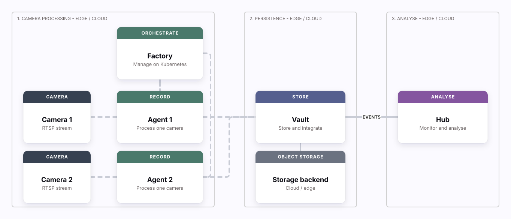
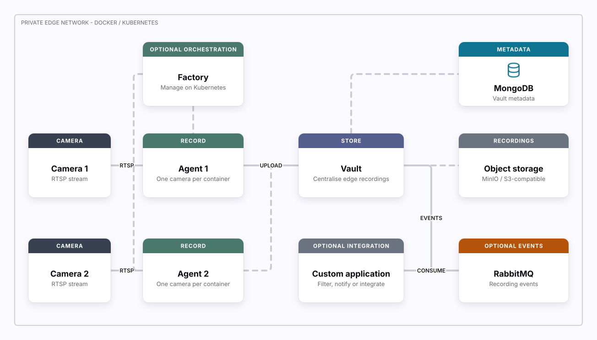
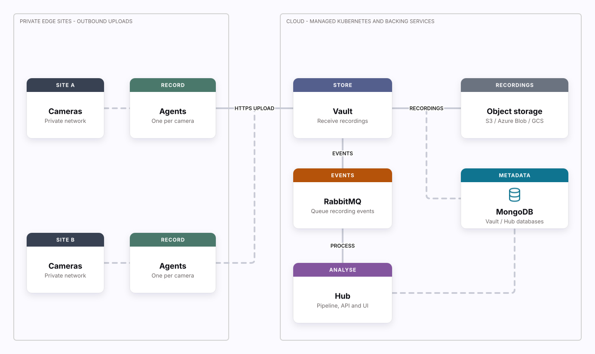

# Deployment

Deploying the ecosystem may initially appear to be a complex task due to its design for scalability from the outset. This entails the integration of several scalable components within a distributed deployment architecture. To streamline the installation process, we have established this repository to offer comprehensive guidance. Our objective is to incorporate as much automation as possible within this repository, thereby ensuring that the installation process is straightforward and user-friendly. At the same time, we remain committed to delivering a scalable and highly available video surveillance system.

[][draw-how-it-works]

[Edit in Draw][draw-how-it-works] · [Diagram source](./assets/diagrams/how-it-works.json)

The ecosystem offers flexible installation options, supporting deployment in hybrid environments, fully in the cloud, or entirely at the edge. This deployment guide covers installing its components. For detailed component documentation, please refer to the links below.

- [Agent](https://learn.uug.ai/docs/agent/)
- [Factory](https://learn.uug.ai/docs/factory/)
- [Vault](https://github.com/kerberos-io/vault)
- [Hub](https://github.com/kerberos-io/hub)

## Continuous deployment

These badges show the latest status of each GitHub Actions workflow on `main`.
Select a badge to view its runs and platform-specific results. The deployment
workflows continuously test the ecosystem across kind, k3d, and MicroK8s; the
Kustomize workflow validates the Kustomize, Garage, and Factory setup.

Kubernetes examples and CI now use **Garage S3** for local object storage.
See the [Garage setup guide](./base/garage/README.md) for generated credentials,
Vault configuration, persistence tests and existing MinIO compatibility.
This is a single-node example, not a replicated production storage deployment.
The [MinIO manifests](./base/minio/) remain available; no existing data is
migrated or removed automatically. The Docker guide retains its separate
storage setup.

Slack notifications are optional. If `SLACK_WEBHOOK_URL` is unavailable (for
example on fork PRs), CI emits a warning and skips delivery without masking
deployment failures. Configured webhook delivery errors still fail the step.
Failed deployment jobs collect pod events and bounded logs for diagnosis.

### Hardened Hub API and frontend

The Kubernetes overlays and full deployment workflows pin Hub chart **0.170.1**.
It supplies Hub API container/pod security contexts for the promoted
`ghcr.io/uug-ai/hub-api:v1.11.31`: UID/GID `65532`, read-only root filesystem,
no privilege escalation, dropped capabilities and RuntimeDefault seccomp.
A disk-backed `hub-api-tmp` emptyDir at `/tmp` provides writable upload scratch
space with pod `fsGroup: 65532`; it is not persistent storage.
Retain this volume and mount when adding custom API mounts, because Helm
replaces lists rather than appending to them.

The promoted frontend image requires Hub chart **0.170.0 or newer**, which
provides port `8080`, non-root/read-only runtime settings and a writable `/tmp`
mount. Both primary and demo frontends use these settings; Admin remains on its
legacy image and port `80`. Keep `global.imageRegistry` empty for the supplied
fully qualified `ghcr.io` image names. Service ports remain `80` and the frontend
NodePort remains `32080`, targeting the container port named `http`.

Run `bash scripts/check-hub-runtime.sh` to check published chart `0.170.1` with these
values before installation, or pass a local chart path as the first argument.
When adding custom branding mounts, preserve the chart's `frontend-tmp` volume
and `/tmp` mount. Existing deployments may require the explicit
[HTTP port migration](https://github.com/kerberos-io/helm-charts/blob/main/charts/hub/README.md#recovering-a-duplicate-http-port-during-upgrades).

## Architecture

As previously indicated, several integral components, including object storage, databases, and message brokers, are deployed and configured to support the ecosystem. The architecture diagrams below provide a visual representation of these components and how they interact in self-hosted and managed cloud deployments.

It is important to note that the ease of installation may vary depending on the chosen Kubernetes distribution and platform. For instance, distributions like Microk8s, which offer an addons feature, may simplify the installation process significantly. Managed Kubernetes services on platforms such as AWS, Azure, GCP, and others offer a range of supplementary services. These include, but are not limited to, cloud-based object storage, load balancers, persistent volumes, and additional resources that enhance the deployment experience. On the other hand running a self-hosted vanilla Kubernetes deployment will come with additinal work as it misses the out-of-the-box components from a managed deployment or the self-hosted Microk8s add-ons feature.

Given these differences, we have created specific architectural frameworks for self-hosted and cloud-based deployments. This approach ensures that each deployment is optimized for its environment, using the unique benefits and services of each platform. In the next section we discuss the different deployment strategies and installation processes.

## Edge (self-hosted) deployment

Edge (self-hosted) deployments are typically used for camera processing and edge storage. In this setup, Agents are deployed and connected to cameras, with recordings stored in the Vault. Additionally, you may want to create integrations, such as [data filtering](https://github.com/uug-ai/data-filtering), to ensure only relevant recordings are retained, or set up custom notifications to your first or third-party platforms. In this edge scenario, hardware is being deployed in the local network to handle the workloads; for example AMD64 or ARM64 processors.

[][draw-deployment-self-hosted]

[Edit in Draw][draw-deployment-self-hosted] · [Diagram source](./assets/diagrams/deployment-self-hosted.json)

Factory is optional and manages Agents when using Kubernetes. Event publishing
and custom integrations are optional; recordings can stay entirely within the
private edge network.

A key aspect of this deployment is the scaling of Agents. Each camera is
assigned a dedicated Agent container, which is linked to a central Vault. Vault
stores metadata in MongoDB, recordings in Garage (or another S3-compatible
object storage), and can generate events in a message broker like RabbitMQ.
This approach enables you to develop custom applications or logic that can
respond to new recordings.

Based on your technology experience and preferences, you can choose from the following deployment guides:

- [[Easy] Install the ecosystem with Docker](/README.docker.md)
- [[Medium] Install the ecosystem with Microk8s](/README.microk8s.md)
- [[Advanced] Install the ecosystem with Kubernetes](/README.k8s.md)

## Managed deployment

Managed deployments are typically executed on cloud platforms such as Azure, Google Cloud Platform (GCP), Amazon Web Services (AWS), among others. The advantage of a managed deployment is that many foundational components are pre-configured and readily available, which is not the case for a self-hosted deployment. For example:

- Object storage: AWS has S3, GCP has Cloud Storage, Azure has Blob Storage.
- Load Balancers: Automatic traffic distribution for high availability.
- Encryption: Built-in data encryption at rest and in transit.
- High availability and scaling: can allocate new compute and storage on the fly.
- etc.

As previously discussed, a managed deployment enhances resilience and high availability by leveraging the cloud provider's existing services as the backbone for your Kubernetes cluster. For example, when deploying a Kubernetes cluster on:

- AWS provides EKS (Elastic Kubernetes Service) which integrates with services like S3 for object storage, EC2 for compute instances, IAM for access management, CloudWatch for monitoring, and RDS for managed databases.
- GCP provides GKE (Google Kubernetes Engine) which utilizes Google Cloud Storage for object storage, Compute Engine for virtual machines, IAM for access control, Stackdriver for monitoring and logging, and Cloud SQL for managed databases.
- Azure provides AKS (Azure Kubernetes Service) which works with Azure Blob Storage for object storage, Virtual Machines for compute resources, Azure Active Directory for identity management, Azure Monitor for monitoring and diagnostics, and Azure SQL Database for managed relational databases.

### Purpose of a Managed Deployment

The primary objective of maintaining a managed, public-facing deployment is to centralize multiple edge deployments through a unified interface. Typically, edge deployments are distributed across various environments such as hospitals, retail stores, and factories. These edge deployments are inherently secure and non-public facing, preventing direct internet access to these environments. To address this challenge, we operate a managed, public-facing environment that consolidates all recordings, live camera views, and permissions into a single, cohesive platform.

[][draw-deployment-managed]

[Edit in Draw][draw-deployment-managed] · [Diagram source](./assets/diagrams/deployment-managed.json)

This example shows Agents uploading directly to cloud Vault, without exposing
the camera networks to inbound internet traffic. Hybrid deployments can retain
an edge Vault and forward selected recordings to cloud Vault instead. The
backing services can be self-hosted or compatible managed services; their logical
roles stay the same.

Based on your technology experience and preferences, you can choose from the following deployment guides:

- [[Medium] Install the ecosystem with Kubernetes (AWS, GCP, Azure, etc.)](/README.k8s-managed.md)

Or provision the infrastructure yourself with infrastructure as code:

- [[AWS] Terraform: EKS cluster + Amazon DocumentDB](./modules/amazon-eks-documentdb/README.md)
- [[Azure] Terraform: Event Hub with 10 partitions](./modules/azure-event-hub/README.md)

## Updating architecture diagrams

These diagrams use the same editable `groups`, `nodes`, and `connections` JSON
format as the [Learn diagrams](https://learn.uug.ai/docs/prologue/how/) and
[Draw](https://draw.uug.ai/). GitHub cannot run Learn's interactive renderer, so
the README uses self-contained SVG exports from Draw, with an **Edit in Draw**
link carrying the source in a base64-encoded UTF-8 URL fragment.

1. Update the corresponding JSON in [assets/diagrams](./assets/diagrams).
   Keep the product colours, labelled zones, cards and orthogonal connectors
   consistent with Learn; the overview follows Learn's solution stack.
2. Run `node scripts/update-diagram-links.mjs` (Node.js 20+) to refresh the
   README's Draw links. Open the updated **Edit in Draw** link, or paste the
   JSON into Draw's **Templates** import.
3. Use Draw's **Export board** action to download an SVG in light mode and
   replace the matching file in [assets/images](./assets/images). Export the
   whole diagram, not a screenshot of the editor. Draw embeds its image assets
   so GitHub does not need external icons or scripts.
4. Run `node scripts/update-diagram-links.mjs --check` and preview the README.
   The check validates source bounds/connections, SVG presence and link
   freshness; also check the exported diagram visually.

Edits on a Draw board do not automatically update this repository. Mirror any
board changes into the JSON source before refreshing the links and SVG. Commit
the source, preview and README links together; do not hand-edit the generated
links below.

<!-- BEGIN GENERATED DRAW LINKS -->
[draw-how-it-works]: https://draw.uug.ai/#diagram=eyJncm91cHMiOlt7ImlkIjoiY2FwdHVyZSIsImxhYmVsIjoiMS4gQ2FtZXJhIHByb2Nlc3NpbmcgLSBlZGdlIC8gY2xvdWQiLCJ4IjowLCJ5IjoyMCwidyI6NTQwLCJoIjo1MjB9LHsiaWQiOiJwZXJzaXN0ZW5jZSIsImxhYmVsIjoiMi4gUGVyc2lzdGVuY2UgLSBlZGdlIC8gY2xvdWQiLCJ4Ijo2MjAsInkiOjIwLCJ3IjozMDAsImgiOjUyMH0seyJpZCI6ImFuYWx5c2lzIiwibGFiZWwiOiIzLiBBbmFseXNlIC0gZWRnZSAvIGNsb3VkIiwieCI6MTAwMCwieSI6MjAsInciOjMwMCwiaCI6NTIwfV0sIm5vZGVzIjpbeyJpZCI6ImNhbWVyYS0xIiwia2luZCI6ImNhbWVyYSIsIngiOjMwLCJ5IjoyMzAsInciOjE4MCwiaCI6MTQwLCJoZWFkZXIiOiJDQU1FUkEiLCJ0aXRsZSI6IkNhbWVyYSAxIiwic3VidGl0bGUiOiJSVFNQIHN0cmVhbSJ9LHsiaWQiOiJjYW1lcmEtMiIsImtpbmQiOiJjYW1lcmEiLCJ4IjozMCwieSI6MzkwLCJ3IjoxODAsImgiOjE0MCwiaGVhZGVyIjoiQ0FNRVJBIiwidGl0bGUiOiJDYW1lcmEgMiIsInN1YnRpdGxlIjoiUlRTUCBzdHJlYW0ifSx7ImlkIjoiZmFjdG9yeSIsImtpbmQiOiJmYWN0b3J5IiwieCI6MjgwLCJ5Ijo2MCwidyI6MjMwLCJoIjoxNDAsImhlYWRlciI6Ik9SQ0hFU1RSQVRFIiwidGl0bGUiOiJGYWN0b3J5Iiwic3VidGl0bGUiOiJNYW5hZ2Ugb24gS3ViZXJuZXRlcyJ9LHsiaWQiOiJhZ2VudC0xIiwia2luZCI6ImFnZW50IiwieCI6MjgwLCJ5IjoyMzAsInciOjIzMCwiaCI6MTQwLCJoZWFkZXIiOiJSRUNPUkQiLCJ0aXRsZSI6IkFnZW50IDEiLCJzdWJ0aXRsZSI6IlByb2Nlc3Mgb25lIGNhbWVyYSJ9LHsiaWQiOiJhZ2VudC0yIiwia2luZCI6ImFnZW50IiwieCI6MjgwLCJ5IjozOTAsInciOjIzMCwiaCI6MTQwLCJoZWFkZXIiOiJSRUNPUkQiLCJ0aXRsZSI6IkFnZW50IDIiLCJzdWJ0aXRsZSI6IlByb2Nlc3Mgb25lIGNhbWVyYSJ9LHsiaWQiOiJ2YXVsdCIsImtpbmQiOiJ2YXVsdCIsIngiOjY1MCwieSI6MjMwLCJ3IjoyNDAsImgiOjE0MCwiaGVhZGVyIjoiU1RPUkUiLCJ0aXRsZSI6IlZhdWx0Iiwic3VidGl0bGUiOiJTdG9yZSBhbmQgaW50ZWdyYXRlIn0seyJpZCI6InN0b3JhZ2UiLCJraW5kIjoic3RvcmFnZSIsIngiOjY1MCwieSI6MzkwLCJ3IjoyNDAsImgiOjE0MCwiaGVhZGVyIjoiT0JKRUNUIFNUT1JBR0UiLCJ0aXRsZSI6IlN0b3JhZ2UgYmFja2VuZCIsInN1YnRpdGxlIjoiQ2xvdWQgLyBlZGdlIn0seyJpZCI6Imh1YiIsImtpbmQiOiJodWIiLCJ4IjoxMDMwLCJ5IjoyMzAsInciOjI0MCwiaCI6MTQwLCJoZWFkZXIiOiJBTkFMWVNFIiwidGl0bGUiOiJIdWIiLCJzdWJ0aXRsZSI6Ik1vbml0b3IgYW5kIGFuYWx5c2UifV0sImNvbm5lY3Rpb25zIjpbeyJmcm9tIjoiY2FtZXJhLTEiLCJ0byI6ImFnZW50LTEiLCJmcm9tU2lkZSI6InJpZ2h0IiwidG9TaWRlIjoibGVmdCJ9LHsiZnJvbSI6ImNhbWVyYS0yIiwidG8iOiJhZ2VudC0yIiwiZnJvbVNpZGUiOiJyaWdodCIsInRvU2lkZSI6ImxlZnQifSx7ImZyb20iOiJmYWN0b3J5IiwidG8iOiJhZ2VudC0xIiwiZnJvbVNpZGUiOiJib3R0b20iLCJ0b1NpZGUiOiJ0b3AiLCJraW5kIjoiZGFzaGVkIn0seyJmcm9tIjoiZmFjdG9yeSIsInRvIjoiYWdlbnQtMiIsImZyb21TaWRlIjoicmlnaHQiLCJ0b1NpZGUiOiJyaWdodCIsImtpbmQiOiJkYXNoZWQifSx7ImZyb20iOiJhZ2VudC0xIiwidG8iOiJ2YXVsdCIsImZyb21TaWRlIjoicmlnaHQiLCJ0b1NpZGUiOiJsZWZ0In0seyJmcm9tIjoiYWdlbnQtMiIsInRvIjoidmF1bHQiLCJmcm9tU2lkZSI6InJpZ2h0IiwidG9TaWRlIjoibGVmdCJ9LHsiZnJvbSI6InZhdWx0IiwidG8iOiJzdG9yYWdlIiwiZnJvbVNpZGUiOiJib3R0b20iLCJ0b1NpZGUiOiJ0b3AifSx7ImZyb20iOiJ2YXVsdCIsInRvIjoiaHViIiwiZnJvbVNpZGUiOiJyaWdodCIsInRvU2lkZSI6ImxlZnQiLCJsYWJlbCI6IkV2ZW50cyJ9XX0=
[draw-deployment-self-hosted]: https://draw.uug.ai/#diagram=eyJncm91cHMiOlt7ImlkIjoiZWRnZSIsImxhYmVsIjoiUHJpdmF0ZSBlZGdlIG5ldHdvcmsgLSBEb2NrZXIgLyBLdWJlcm5ldGVzIiwieCI6MCwieSI6MjAsInciOjEyNDAsImgiOjY4MH1dLCJub2RlcyI6W3siaWQiOiJjYW1lcmEtMSIsImtpbmQiOiJjYW1lcmEiLCJ4IjozMCwieSI6MjgwLCJ3IjoxODAsImgiOjE0MCwiaGVhZGVyIjoiQ0FNRVJBIiwidGl0bGUiOiJDYW1lcmEgMSIsInN1YnRpdGxlIjoiUlRTUCBzdHJlYW0ifSx7ImlkIjoiY2FtZXJhLTIiLCJraW5kIjoiY2FtZXJhIiwieCI6MzAsInkiOjUxMCwidyI6MTgwLCJoIjoxNDAsImhlYWRlciI6IkNBTUVSQSIsInRpdGxlIjoiQ2FtZXJhIDIiLCJzdWJ0aXRsZSI6IlJUU1Agc3RyZWFtIn0seyJpZCI6ImZhY3RvcnkiLCJraW5kIjoiZmFjdG9yeSIsIngiOjI4MCwieSI6ODAsInciOjIyMCwiaCI6MTQwLCJoZWFkZXIiOiJPUFRJT05BTCBPUkNIRVNUUkFUSU9OIiwidGl0bGUiOiJGYWN0b3J5Iiwic3VidGl0bGUiOiJNYW5hZ2Ugb24gS3ViZXJuZXRlcyJ9LHsiaWQiOiJhZ2VudC0xIiwia2luZCI6ImFnZW50IiwieCI6MjgwLCJ5IjoyODAsInciOjIyMCwiaCI6MTQwLCJoZWFkZXIiOiJSRUNPUkQiLCJ0aXRsZSI6IkFnZW50IDEiLCJzdWJ0aXRsZSI6Ik9uZSBjYW1lcmEgcGVyIGNvbnRhaW5lciJ9LHsiaWQiOiJhZ2VudC0yIiwia2luZCI6ImFnZW50IiwieCI6MjgwLCJ5Ijo1MTAsInciOjIyMCwiaCI6MTQwLCJoZWFkZXIiOiJSRUNPUkQiLCJ0aXRsZSI6IkFnZW50IDIiLCJzdWJ0aXRsZSI6Ik9uZSBjYW1lcmEgcGVyIGNvbnRhaW5lciJ9LHsiaWQiOiJ2YXVsdCIsImtpbmQiOiJ2YXVsdCIsIngiOjYyMCwieSI6MjgwLCJ3IjoyMzAsImgiOjE0MCwiaGVhZGVyIjoiU1RPUkUiLCJ0aXRsZSI6IlZhdWx0Iiwic3VidGl0bGUiOiJDZW50cmFsaXNlIGVkZ2UgcmVjb3JkaW5ncyJ9LHsiaWQiOiJtb25nb2RiIiwia2luZCI6ImRhdGFiYXNlIiwieCI6OTcwLCJ5Ijo4MCwidyI6MjQwLCJoIjoxNDAsImhlYWRlciI6Ik1FVEFEQVRBIiwidGl0bGUiOiJNb25nb0RCIiwic3VidGl0bGUiOiJWYXVsdCBtZXRhZGF0YSJ9LHsiaWQiOiJzdG9yYWdlIiwia2luZCI6InN0b3JhZ2UiLCJ4Ijo5NzAsInkiOjI4MCwidyI6MjQwLCJoIjoxNDAsImhlYWRlciI6IlJFQ09SRElOR1MiLCJ0aXRsZSI6Ik9iamVjdCBzdG9yYWdlIiwic3VidGl0bGUiOiJNaW5JTyAvIFMzLWNvbXBhdGlibGUifSx7ImlkIjoiYnJva2VyIiwia2luZCI6ImFtcXAiLCJ4Ijo5NzAsInkiOjUxMCwidyI6MjQwLCJoIjoxNDAsImhlYWRlciI6Ik9QVElPTkFMIEVWRU5UUyIsInRpdGxlIjoiUmFiYml0TVEiLCJzdWJ0aXRsZSI6IlJlY29yZGluZyBldmVudHMifSx7ImlkIjoiaW50ZWdyYXRpb24iLCJraW5kIjoiZGVmYXVsdCIsIngiOjYyMCwieSI6NTEwLCJ3IjoyMzAsImgiOjE0MCwiaGVhZGVyIjoiT1BUSU9OQUwgSU5URUdSQVRJT04iLCJ0aXRsZSI6IkN1c3RvbSBhcHBsaWNhdGlvbiIsInN1YnRpdGxlIjoiRmlsdGVyLCBub3RpZnkgb3IgaW50ZWdyYXRlIn1dLCJjb25uZWN0aW9ucyI6W3siZnJvbSI6ImNhbWVyYS0xIiwidG8iOiJhZ2VudC0xIiwiZnJvbVNpZGUiOiJyaWdodCIsInRvU2lkZSI6ImxlZnQiLCJsYWJlbCI6IlJUU1AifSx7ImZyb20iOiJjYW1lcmEtMiIsInRvIjoiYWdlbnQtMiIsImZyb21TaWRlIjoicmlnaHQiLCJ0b1NpZGUiOiJsZWZ0IiwibGFiZWwiOiJSVFNQIn0seyJmcm9tIjoiZmFjdG9yeSIsInRvIjoiYWdlbnQtMSIsImZyb21TaWRlIjoiYm90dG9tIiwidG9TaWRlIjoidG9wIiwia2luZCI6ImRhc2hlZCJ9LHsiZnJvbSI6ImZhY3RvcnkiLCJ0byI6ImFnZW50LTIiLCJmcm9tU2lkZSI6ImxlZnQiLCJ0b1NpZGUiOiJsZWZ0Iiwia2luZCI6ImRhc2hlZCJ9LHsiZnJvbSI6ImFnZW50LTIiLCJ0byI6InZhdWx0IiwiZnJvbVNpZGUiOiJyaWdodCIsInRvU2lkZSI6ImxlZnQifSx7ImZyb20iOiJhZ2VudC0xIiwidG8iOiJ2YXVsdCIsImZyb21TaWRlIjoicmlnaHQiLCJ0b1NpZGUiOiJsZWZ0IiwibGFiZWwiOiJVcGxvYWQifSx7ImZyb20iOiJ2YXVsdCIsInRvIjoibW9uZ29kYiIsImZyb21TaWRlIjoidG9wIiwidG9TaWRlIjoibGVmdCJ9LHsiZnJvbSI6InZhdWx0IiwidG8iOiJzdG9yYWdlIiwiZnJvbVNpZGUiOiJyaWdodCIsInRvU2lkZSI6ImxlZnQifSx7ImZyb20iOiJ2YXVsdCIsInRvIjoiYnJva2VyIiwiZnJvbVNpZGUiOiJyaWdodCIsInRvU2lkZSI6ImxlZnQiLCJsYWJlbCI6IkV2ZW50cyJ9LHsiZnJvbSI6ImJyb2tlciIsInRvIjoiaW50ZWdyYXRpb24iLCJmcm9tU2lkZSI6ImxlZnQiLCJ0b1NpZGUiOiJyaWdodCIsImxhYmVsIjoiQ29uc3VtZSJ9XX0=
[draw-deployment-managed]: https://draw.uug.ai/#diagram=eyJncm91cHMiOlt7ImlkIjoiZWRnZSIsImxhYmVsIjoiUHJpdmF0ZSBlZGdlIHNpdGVzIC0gb3V0Ym91bmQgdXBsb2FkcyIsIngiOjAsInkiOjIwLCJ3Ijo1MDAsImgiOjc2MH0seyJpZCI6ImNsb3VkIiwibGFiZWwiOiJDbG91ZCAtIG1hbmFnZWQgS3ViZXJuZXRlcyBhbmQgYmFja2luZyBzZXJ2aWNlcyIsIngiOjYyMCwieSI6MjAsInciOjcwMCwiaCI6NzYwfV0sIm5vZGVzIjpbeyJpZCI6ImNhbWVyYS0xIiwia2luZCI6ImNhbWVyYSIsIngiOjMwLCJ5IjoxNzAsInciOjE4MCwiaCI6MTQwLCJoZWFkZXIiOiJTSVRFIEEiLCJ0aXRsZSI6IkNhbWVyYXMiLCJzdWJ0aXRsZSI6IlByaXZhdGUgbmV0d29yayJ9LHsiaWQiOiJjYW1lcmEtMiIsImtpbmQiOiJjYW1lcmEiLCJ4IjozMCwieSI6NTMwLCJ3IjoxODAsImgiOjE0MCwiaGVhZGVyIjoiU0lURSBCIiwidGl0bGUiOiJDYW1lcmFzIiwic3VidGl0bGUiOiJQcml2YXRlIG5ldHdvcmsifSx7ImlkIjoiYWdlbnQtMSIsImtpbmQiOiJhZ2VudCIsIngiOjI3MCwieSI6MTcwLCJ3IjoyMDAsImgiOjE0MCwiaGVhZGVyIjoiUkVDT1JEIiwidGl0bGUiOiJBZ2VudHMiLCJzdWJ0aXRsZSI6Ik9uZSBwZXIgY2FtZXJhIn0seyJpZCI6ImFnZW50LTIiLCJraW5kIjoiYWdlbnQiLCJ4IjoyNzAsInkiOjUzMCwidyI6MjAwLCJoIjoxNDAsImhlYWRlciI6IlJFQ09SRCIsInRpdGxlIjoiQWdlbnRzIiwic3VidGl0bGUiOiJPbmUgcGVyIGNhbWVyYSJ9LHsiaWQiOiJ2YXVsdCIsImtpbmQiOiJ2YXVsdCIsIngiOjY1MCwieSI6MTcwLCJ3IjoyMzAsImgiOjE0MCwiaGVhZGVyIjoiU1RPUkUiLCJ0aXRsZSI6IlZhdWx0Iiwic3VidGl0bGUiOiJSZWNlaXZlIHJlY29yZGluZ3MifSx7ImlkIjoic3RvcmFnZSIsImtpbmQiOiJzdG9yYWdlIiwieCI6MTA0MCwieSI6MTcwLCJ3IjoyNTAsImgiOjE0MCwiaGVhZGVyIjoiUkVDT1JESU5HUyIsInRpdGxlIjoiT2JqZWN0IHN0b3JhZ2UiLCJzdWJ0aXRsZSI6IlMzIC8gQXp1cmUgQmxvYiAvIEdDUyJ9LHsiaWQiOiJicm9rZXIiLCJraW5kIjoiYW1xcCIsIngiOjY1MCwieSI6MzgwLCJ3IjoyMzAsImgiOjE0MCwiaGVhZGVyIjoiRVZFTlRTIiwidGl0bGUiOiJSYWJiaXRNUSIsInN1YnRpdGxlIjoiUXVldWUgcmVjb3JkaW5nIGV2ZW50cyJ9LHsiaWQiOiJtb25nb2RiIiwia2luZCI6ImRhdGFiYXNlIiwieCI6MTA0MCwieSI6MzgwLCJ3IjoyNTAsImgiOjE0MCwiaGVhZGVyIjoiTUVUQURBVEEiLCJ0aXRsZSI6Ik1vbmdvREIiLCJzdWJ0aXRsZSI6IlZhdWx0IC8gSHViIGRhdGFiYXNlcyJ9LHsiaWQiOiJodWIiLCJraW5kIjoiaHViIiwieCI6NjUwLCJ5Ijo2MDAsInciOjIzMCwiaCI6MTQwLCJoZWFkZXIiOiJBTkFMWVNFIiwidGl0bGUiOiJIdWIiLCJzdWJ0aXRsZSI6IlBpcGVsaW5lLCBBUEkgYW5kIFVJIn1dLCJjb25uZWN0aW9ucyI6W3siZnJvbSI6ImNhbWVyYS0xIiwidG8iOiJhZ2VudC0xIiwiZnJvbVNpZGUiOiJyaWdodCIsInRvU2lkZSI6ImxlZnQifSx7ImZyb20iOiJjYW1lcmEtMiIsInRvIjoiYWdlbnQtMiIsImZyb21TaWRlIjoicmlnaHQiLCJ0b1NpZGUiOiJsZWZ0In0seyJmcm9tIjoiYWdlbnQtMiIsInRvIjoidmF1bHQiLCJmcm9tU2lkZSI6InJpZ2h0IiwidG9TaWRlIjoibGVmdCJ9LHsiZnJvbSI6ImFnZW50LTEiLCJ0byI6InZhdWx0IiwiZnJvbVNpZGUiOiJyaWdodCIsInRvU2lkZSI6ImxlZnQiLCJsYWJlbCI6IkhUVFBTIHVwbG9hZCJ9LHsiZnJvbSI6InZhdWx0IiwidG8iOiJtb25nb2RiIiwiZnJvbVNpZGUiOiJyaWdodCIsInRvU2lkZSI6ImxlZnQifSx7ImZyb20iOiJ2YXVsdCIsInRvIjoic3RvcmFnZSIsImZyb21TaWRlIjoicmlnaHQiLCJ0b1NpZGUiOiJsZWZ0IiwibGFiZWwiOiJSZWNvcmRpbmdzIn0seyJmcm9tIjoidmF1bHQiLCJ0byI6ImJyb2tlciIsImZyb21TaWRlIjoiYm90dG9tIiwidG9TaWRlIjoidG9wIiwibGFiZWwiOiJFdmVudHMifSx7ImZyb20iOiJicm9rZXIiLCJ0byI6Imh1YiIsImZyb21TaWRlIjoiYm90dG9tIiwidG9TaWRlIjoidG9wIiwibGFiZWwiOiJQcm9jZXNzIn0seyJmcm9tIjoiaHViIiwidG8iOiJtb25nb2RiIiwiZnJvbVNpZGUiOiJyaWdodCIsInRvU2lkZSI6ImJvdHRvbSJ9XX0=
<!-- END GENERATED DRAW LINKS -->
